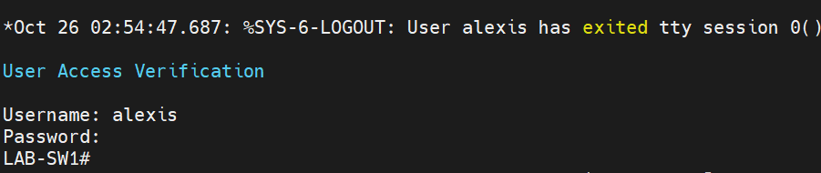

# 🔌 Phase 1 — Switch Baseline (LAB-SW1)


[← Back to main page](../README.md)

## Lab Summary
Took a Cisco Catalyst C9200CX from factory defaults to a hardened, remotely managed access switch: secured console and remote access, enabled SSH-only management, built an in-band management VLAN, and configured end-host access ports.

## What I Built & Configured
- 🔐 Secured console and VTY access with local authentication and idle timeouts
- 🔑 Stored all credentials as **type 9 (scrypt)** hashes
- 🖥️ Enabled **SSH v2 only** with a 2048-bit RSA key; disabled Telnet and plain HTTP
- 🌐 Built management VLAN 100 with an in-band SVI and default gateway
- 💻 Configured PortFast access ports for end devices

## 🔧 Step-by-Step Walkthrough

### Step 1 — Review the Factory Configuration
Captured `show running-config` to establish a baseline before making changes.

| Finding | Risk |
|---|---|
| Console had no login | Anyone with a console cable gets admin access |
| No management IP | SSH configured but unreachable |
| Plain HTTP server enabled | Web logins sent unencrypted |
| No dedicated management port | Management must be in-band |

### Step 2 — Harden Console Access
```
line con 0
 login local
 exec-timeout 10 0
 logging synchronous
line vty 0 15
 exec-timeout 10 0
```

| Command | Purpose |
|---|---|
| `login local` | Requires username/password from the local account database |
| `exec-timeout 10 0` | Logs out idle sessions after 10 minutes |
| `logging synchronous` | Stops log messages from interrupting typed commands |

Tested by logging out and back in **before** saving, so a mistake couldn't cause a lockout.



### Step 3 — Enable SSH
```
crypto key generate rsa modulus 2048
ip ssh version 2
ip ssh time-out 60
ip ssh authentication-retries 3
no ip http server
```

| Command | Purpose |
|---|---|
| `crypto key generate rsa modulus 2048` | Creates the key pair SSH needs (this enables SSH on IOS-XE) |
| `ip ssh version 2` | Blocks the flawed SSH v1 protocol |
| `ip ssh time-out 60` | Drops unfinished logins after 60 seconds |
| `ip ssh authentication-retries 3` | Limits password guessing per connection |
| `no ip http server` | Disables the unencrypted web UI (HTTPS remains) |


### Step 4 — Build the Management VLAN
```
vlan 100
 name MGMT
interface Vlan100
 ip address 192.168.1.245 255.255.255.0
 no shutdown
ip default-gateway 192.168.1.1
```

| Decision | Reason |
|---|---|
| VLAN 100 instead of VLAN 1 | VLAN 1 is the default for every port; keeping management off it is best practice |
| `.245` address | High in the subnet, clear of the home router's DHCP pool |
| `ip default-gateway` | IP routing is off (pure Layer 2), so the switch acts like a host |

### Step 5 — Configure the Uplink and Access Ports
```
interface GigabitEthernet1/0/12
 description TEMP-UPLINK-HOME
 switchport mode access
 switchport access vlan 100
!
interface GigabitEthernet1/0/1
 description PC-LAPTOP
 switchport mode access
 switchport access vlan 100
 spanning-tree portfast
```
`spanning-tree portfast` skips the STP listening/learning delay on end-device ports, so clients get DHCP immediately. It is never used on switch-to-switch links.

### Step 6 — Verify Remote Management
SSH from the laptop to `192.168.1.245` via MobaXterm succeeded.


## 🛠️ Troubleshooting & Challenges

### Access Port Would Not Come Up
❌ **Problem:** Gi1/0/1 stayed down after configuration.

🔍 **Root Cause:** The port was in a shutdown/disabled state even though the earlier config snapshot showed no `shutdown` command.

✅ **Fix:** Applied `no shutdown` on the interface; the link came up and the PC received an address.

### Separate Subnet for the PC Wasn't Possible Yet
❌ **Problem:** Wanted the PC on its own subnet.

🔍 **Root Cause:** The switch is Layer 2 only and the home router isn't VLAN-aware, so nothing could route or provide DHCP for a new VLAN.

✅ **Fix:** Placed the PC in VLAN 100 temporarily; true segmentation is deferred to the firewall phase, where OPNsense routes between VLANs.

## ✅ Phase Completion Summary

| Task | Status |
|---|---|
| Console secured with local login + timeout | ✅ |
| Credentials stored as type 9 hashes | ✅ |
| SSH v2 only, Telnet and HTTP disabled | ✅ |
| Management VLAN 100 with SVI | ✅ |
| Remote SSH management verified | ✅ |
| PortFast access port for PC | ✅ |

## 📚 What I Learned
How a switch secures its own management plane, why the management VLAN should be separate from VLAN 1, and the difference between Layer 2 separation (VLANs) and Layer 3 routing. Hitting the "no router for the new VLAN" limitation made it clear why segmentation needs a routing and firewall layer, which shaped the rest of this project.
