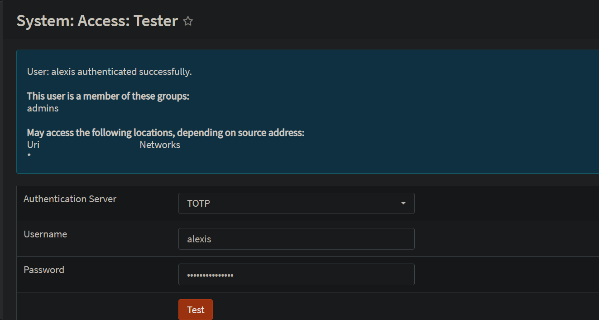
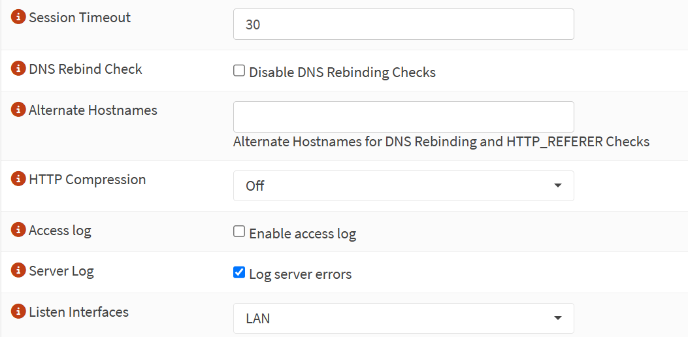

# 🔐 Phase 3 — OPNsense Firewall Hardening

[← Back to main page](../README.md)

## Lab Summary
Hardened the firewall's own management plane before trusting it to protect the network: replaced daily use of `root` with a named admin account, enforced TOTP two-factor authentication on the web GUI, restricted where the GUI listens, and kept SSH disabled to minimize the attack surface.

## What I Built & Configured
- 👤 Created a named admin account with privileges inherited through the `admins` group
- 🔑 Enforced **TOTP multi-factor authentication** for all web GUI logins
- 🧪 Tested MFA with the built-in authentication tester **before** enforcing it
- 🌐 Restricted the web GUI to the LAN interface only (removed WAN exposure)
- ⏱️ Set a 30-minute session timeout
- 🚫 Kept SSH disabled
- 💾 Captured the hardened state in a new configuration backup

## 🔧 Step-by-Step Walkthrough

### Step 1 — Create a Named Admin Account
Using `root` for daily administration means every log entry says "root," with no accountability. A named account ties every change to a person.

| Setting | Value |
|---|---|
| Username | Named, non-default account |
| Group | `admins` (privileges inherited from the group) |
| `root` | Kept as console-only break-glass account |

Privileges were assigned through **group membership** rather than directly to the user, the same role-based approach used with Active Directory security groups.

### Step 2 — Configure TOTP Two-Factor Authentication

| Step | Location | Action |
|---|---|---|
| Create auth server | System → Access → Servers | Type: Local + Timebased One Time Password |
| Enroll user | System → Access → Users | Generate OTP seed, scan QR into authenticator app |
| **Test first** | System → Access → Tester | Code + password → "authenticated successfully" |
| Enforce | System → Settings → Administration | TOTP selected, Local Database deselected |

Testing before enforcing ensured a misconfiguration couldn't lock me out of the GUI.

*TOTP verified with the built-in tester before being enforced.*

> 🔒 The QR code and OTP seed were intentionally not captured. They are the secret itself.

### Step 3 — Reduce Web GUI Exposure

| Setting | Before | After | Reason |
|---|---|---|---|
| Listen Interfaces | All (incl. WAN) | LAN | No reason for the GUI to listen on the internet-facing side |
| Session Timeout | Default | 30 minutes | Unattended sessions log out automatically |
| DNS Rebind Check | Enabled | Enabled | Blocks DNS rebinding attacks against the GUI |
| Anti-lockout Rule | Enabled | Enabled | Guarantees LAN access while the network is being built |

*Web GUI restricted to the LAN interface with a 30-minute session timeout.*

### Step 4 — Keep SSH Disabled
The GUI (with MFA) and the physical console cover all administration needs, so SSH stays off. If it's ever needed, it will be enabled **key-only, with root login disabled, on the management network only**.

### Step 5 — Back Up the Hardened Configuration
Downloaded a new configuration backup capturing the hardened state, stored offline alongside the Phase 2 baseline.

## 🛠️ Challenges & Considerations

### Avoiding an MFA Lockout
❌ **Risk:** Enforcing TOTP before confirming it works could lock every admin out of the GUI.

🔍 **Approach:** Separated setup from enforcement, so MFA was only enforced after a successful test.

✅ **Safeguards in place:**
- MFA tested with System → Access → Tester before enforcement
- Original session kept open while testing a new login in a private window
- `root` retained for console access as a break-glass path
- Recovery options: console "Restore web GUI access defaults" or config restore

### Root Can No Longer Use the Web GUI
🔍 **Observation:** `root` has no OTP seed, so it can't authenticate against the TOTP server.

✅ **By design:** `root` is now console-only, limiting the most privileged account to physical access.

## ✅ Phase Completion Summary

| Task | Status |
|---|---|
| Named admin account via group membership | ✅ |
| TOTP MFA tested and enforced | ✅ |
| Web GUI restricted to LAN | ✅ |
| 30-minute session timeout | ✅ |
| SSH disabled | ✅ |
| Hardened config backed up | ✅ |

## 📚 What I Learned
A security device has to be secured first, or it becomes the easiest way into the network it protects. I applied least privilege and accountability (named accounts instead of shared `root`), multi-factor authentication, and attack-surface reduction, and learned to plan changes so a mistake can't lock me out. Testing a control before enforcing it is a habit I'll carry into every phase.
