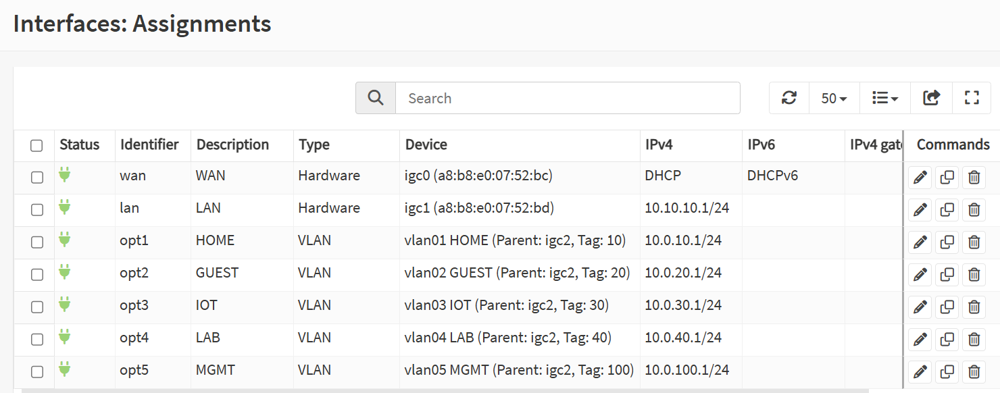
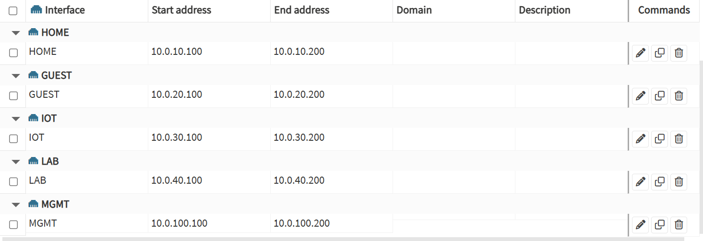
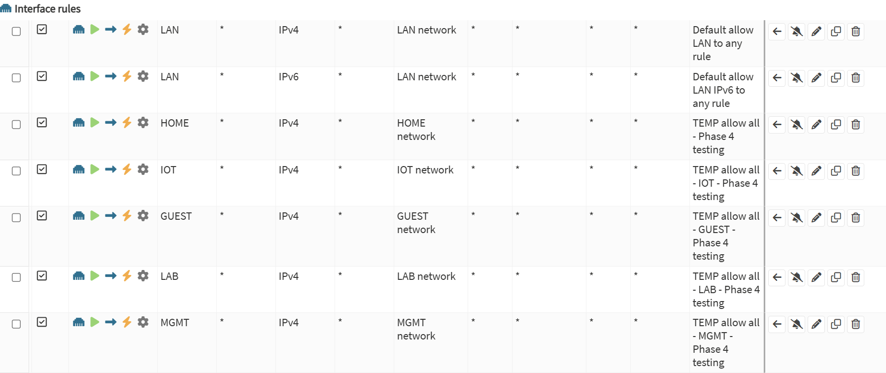
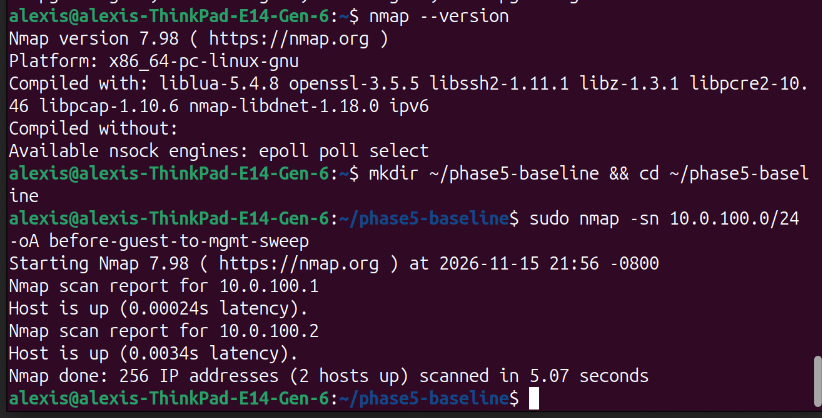
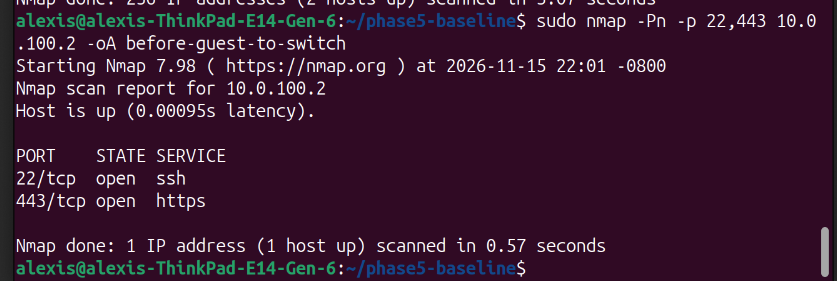
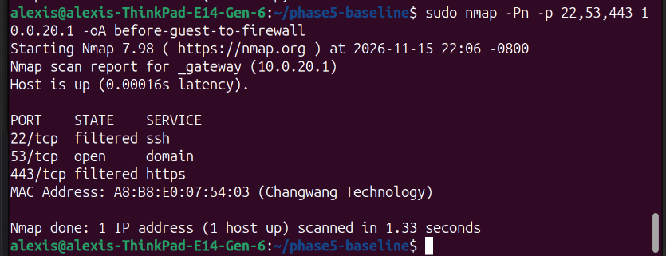

# 🧱 Phase 4 — VLAN Segmentation + 802.1Q Trunk


[← Back to main page](../README.md)

## Lab Summary
Built network segmentation with five VLANs routed by OPNsense over a single 802.1Q trunk to the Cisco Catalyst switch. Each VLAN has its own subnet, gateway, and DHCP scope, so every packet crossing a VLAN boundary passes through the stateful firewall. Moved switch management behind the firewall, verified VLANs end to end, and captured an Nmap baseline from the guest network to measure Phase 5's firewall rules against.

## What I Built & Configured
- 🧭 Mapped the existing ISP equipment and redesigned the WAN path so the internet-facing side never touches the switch
- 📐 Designed an IP plan where the VLAN ID matches the third octet
- 🏷️ Created five 802.1Q VLAN interfaces on a dedicated trunk port (`igc2`)
- 🔗 Built an 802.1Q trunk on the Catalyst with pruned VLANs and DTP disabled
- 🖥️ Moved switch management into the MGMT VLAN behind the firewall
- 📡 Extended DHCP to every VLAN with reserved space for static devices
- 🔥 Added temporary, clearly labeled test rules scoped to each VLAN's own subnet
- 🧪 Verified HOME, GUEST, and MGMT end to end
- 🔍 Captured an Nmap "before" baseline from GUEST, producing two findings for Phase 5

## 🗺️ Network Design

### Existing ISP Equipment
```
Coax → Spectrum E31U2V1 (cable modem only) → Spectrum Wi-Fi router (192.168.1.1)
```
The modem has no routing or Wi-Fi, so **bridge mode isn't needed**. At final cutover, OPNsense's WAN cable moves from the Spectrum router to the modem, and the Spectrum router is reused as a temporary single-network access point on the HOME VLAN until a VLAN-aware AP is installed.

### Current Topology
```
Spectrum router → OPNsense igc0 (WAN)
                  OPNsense igc1 (admin port) → admin laptop
                  OPNsense igc2 (802.1Q trunk) → LAB-SW1 Gi1/0/11
                                                   ├── Gi1/0/1 → PC (HOME)
                                                   └── Gi1/0/2 → test port (GUEST)
```

### IP Plan

| VLAN | Name | Subnet | Gateway | DHCP Range |
|---|---|---|---|---|
| 10 | HOME | 10.0.10.0/24 | 10.0.10.1 | .100 – .200 |
| 20 | GUEST | 10.0.20.0/24 | 10.0.20.1 | .100 – .200 |
| 30 | IOT | 10.0.30.0/24 | 10.0.30.1 | .100 – .200 |
| 40 | LAB | 10.0.40.0/24 | 10.0.40.1 | .100 – .200 |
| 100 | MGMT | 10.0.100.0/24 | 10.0.100.1 | .100 – .200 |
| — | LAN (admin port, igc1) | 10.10.10.0/24 | 10.10.10.1 | .100 – .200 |

Addresses `.2`–`.99` in each VLAN are reserved for static devices. The switch is at **10.0.100.2**.

### Firewall Port Roles

| Port | Interface | Role |
|---|---|---|
| igc0 | WAN | Internet (currently via Spectrum router) |
| igc1 | LAN | Dedicated admin port, a safe path to the GUI during changes |
| igc2 | TRUNK | 802.1Q trunk carrying VLANs 10, 20, 30, 40, 100 (no IP of its own) |
| igc3 | — | Spare |

## 🔧 Step-by-Step Walkthrough

### Section A — OPNsense Configuration ✅

#### Step 1 — Create VLAN Devices
**Interfaces → Devices → VLAN.** Five VLANs, all with parent `igc2`: 10 HOME, 20 GUEST, 30 IOT, 40 LAB, 100 MGMT. Each VLAN becomes a virtual interface on one physical port; the 802.1Q tag on each frame tells the firewall which network it belongs to.

#### Step 2 — Assign and Address the Interfaces
Each VLAN was assigned as an interface, enabled, and given a static gateway address from the IP plan. The parent port `igc2` was also assigned as **TRUNK**, enabled, with no IP address.


*All five VLANs on igc2 with gateway addresses from the IP plan; the LAN admin port stays separate at 10.10.10.1.*

#### Step 3 — DHCP per VLAN

| Decision | Reason |
|---|---|
| Used **Dnsmasq** | Already serving LAN; also registers DHCP hostnames in DNS |


*Dnsmasq DHCP scope for each VLAN, .100–.200, leaving .2–.99 for static devices.*

#### Step 4 — Temporary Test Rules
New interfaces block all traffic by default. One temporary pass rule per VLAN proves the plumbing works before real policy is written in Phase 5.

| Field | Value | Why |
|---|---|---|
| Interface (rule) | The VLAN | Applies to traffic entering that VLAN |
| Interface (origin) | Empty | "Received on" is only valid for outbound rules |
| Source | `<VLAN> network` | Only matches the VLAN's own subnet (anti-spoofing) |
| Destination | any | Temporary, for connectivity testing |
| State | keep state | Stateful: replies allowed automatically |
| Description | `TEMP allow all - <VLAN> - Phase 4 testing` | Easy to find and delete in Phase 5 |


*Temporary per-VLAN pass rules, each scoped to its own subnet and labeled for removal in Phase 5.*

### Section B — Switch Trunk + Management Move ✅

#### Step 5 — Create VLANs on the Switch
```
vlan 10
 name HOME
vlan 20
 name GUEST
vlan 30
 name IOT
vlan 40
 name LAB
```

#### Step 6 — Redesign the WAN Path
The original plan carried the ISP side through the switch in a dedicated "WAN-TRANSIT" VLAN. Since the firewall could reach the Spectrum router directly, I cabled it straight to `igc0` instead, so the **internet-facing segment never touches the switch**. A switch misconfiguration can no longer expose the outside network.

The old WAN-path ports were disabled and labeled:
```
interface range GigabitEthernet1/0/3 , GigabitEthernet1/0/12
 description UNUSED
 shutdown
```

#### Step 7 — Build the 802.1Q Trunk
```
interface GigabitEthernet1/0/11
 description TRUNK-OPNSENSE-igc2
 switchport mode trunk
 switchport trunk allowed vlan 10,20,30,40,100
 switchport nonegotiate
```

| Command | Purpose |
|---|---|
| `switchport mode trunk` | Carries multiple VLANs, each frame tagged with its VLAN ID |
| `switchport trunk allowed vlan 10,20,30,40,100` | Only the VLANs OPNsense routes cross the trunk (pruning) |
| `switchport nonegotiate` | Disables DTP so the port can't be tricked into trunk negotiation (VLAN hopping protection) |

#### Step 8 — Move Switch Management Behind the Firewall
```
interface Vlan100
 ip address 10.0.100.2 255.255.255.0
ip default-gateway 10.0.100.1
```
The switch moved from the old home network (192.168.1.245) into the MGMT VLAN. Because it's Layer 2 only, `ip default-gateway` lets it reply to admins on other subnets through OPNsense. **The switch is now managed through the firewall.**

### Section C — Per-VLAN Testing ✅

| VLAN | Test Device | Result |
|---|---|---|
| HOME | Windows PC on Gi1/0/1 | ✅ 10.0.10.x lease, gateway, internet, DNS |
| GUEST | Ubuntu laptop on Gi1/0/2 | ✅ 10.0.20.x lease, default route via 10.0.20.1, internet (system updates) |
| MGMT | LAB-SW1 | ✅ Switch reached its gateway 10.0.100.1 across the trunk |
| IOT / LAB | — | Configured identically; to be verified when devices are added |


### Section D — Nmap "Before" Baseline 🔍
With the temporary allow-all rules still in place, I scanned from the **GUEST** network to record what a visitor can reach. These results are the "before" picture that Phase 5's rules will be measured against.

**Scan 1 — Can a guest discover management devices?**
```
sudo nmap -sn 10.0.100.0/24 -oA before-guest-to-mgmt-sweep
```


**Scan 2 — Can a guest reach the switch's management services?**
```
sudo nmap -Pn -p 22,443 10.0.100.2 -oA before-guest-to-switch
```


**Scan 3 — What can a guest reach on the firewall itself?**
```
sudo nmap -Pn -p 22,53,443 10.0.20.1 -oA before-guest-to-firewall
```


| # | Scan | Result | Interpretation |
|---|---|---|---|
| 1 | MGMT host discovery | 10.0.100.1 and 10.0.100.2 up | ❌ **Finding:** guests can discover management devices |
| 2 | Switch ports 22, 443 | Both **open** | ❌ **Finding:** guests can reach the switch's SSH and HTTPS logins |
| 3 | Firewall ports 22, 53, 443 | 22 filtered, 53 open, 443 filtered | ✅ Phase 3 controls hold: SSH off, GUI on LAN only; DNS open as intended |

**Observations:**
- **No MAC addresses in Scan 1, but one in Scan 3.** MGMT is a different subnet, so packets were routed and MACs don't cross a router. The guest gateway is on the same subnet, so its MAC is visible. This shows exactly where the routing boundary is.
- **"Filtered" vs. "closed":** filtered means packets were silently dropped with no reply, so an attacker can't even confirm a service exists.
- The firewall's MAC vendor prefix identifies its board manufacturer. It's minor, but it shows how much a scanner learns passively.

**Planned fixes:**
- **Phase 5:** block GUEST (and other untrusted VLANs) from MGMT at the firewall
- **Defense in depth on the switch:** disable its unused HTTPS server and restrict SSH to the admin network with a VTY access-class ACL, so one mistake doesn't expose the switch

## 🛠️ Troubleshooting & Challenges

### Subnet Overlap Between HOME and the Admin Port
❌ **Problem:** HOME (VLAN 10) was first addressed as 10.10.10.1/24, the same subnet as the LAN admin port on `igc1`.

🔍 **Root Cause:** Two interfaces in the same subnet make routing ambiguous; the firewall can't tell which interface 10.10.10.x devices live on.

✅ **Fix:** Re-addressed all VLANs to 10.0.X.0/24 (VLAN ID = third octet), keeping the admin port at 10.10.10.1. Done from the GUI on the VLAN interfaces, never the interface I was connected through, so there was no lockout risk.

### Rule Sources Saved as "any"
❌ **Problem:** The first temporary rules showed `*` as the source instead of the VLAN's network.

🔍 **Root Cause:** The source selection didn't persist when the rules were created.

✅ **Fix:** Edited each rule to use `<VLAN> network` and verified the rules list showed the correct source.

### PC Had a Link but No IP Address
❌ **Problem:** After the trunk came up, the PC on the HOME port had an Ethernet link but never received a DHCP lease.

🔍 **Diagnosis:** Assigned the PC a static IP (10.0.10.50) and pinged the gateway. It **also failed**, proving the problem was the network path, not DHCP.

🔍 **Root Cause:** The VLAN parent port `igc2` showed **"up (disabled)"**: the cable had a link, but the interface carrying all five VLANs was turned off in OPNsense.

✅ **Fix:** Assigned `igc2` as **TRUNK**, enabled it with no IP address, and applied. The PC immediately received a 10.0.10.x lease.

### Finding: Default Admin Credentials on the ISP Router
🔍 The Spectrum router's label lists a default admin login. Flagged to verify it has been changed and to disable WPS before the router is repurposed as an access point.

## ✅ Phase Completion Summary

| Task | Status |
|---|---|
| ISP equipment mapped, WAN path redesigned | ✅ |
| IP plan (VLAN ID = third octet) | ✅ |
| Five VLAN interfaces on `igc2` + TRUNK parent enabled | ✅ |
| DHCP scope per VLAN | ✅ |
| Temporary per-VLAN test rules | ✅ |
| Switch VLANs created, unused ports shut down | ✅ |
| 802.1Q trunk (pruned, DTP disabled) | ✅ |
| Switch management moved to MGMT VLAN | ✅ |
| HOME, GUEST, MGMT verified end to end | ✅ |
| Nmap "before" baseline captured | ✅ |

## 📚 What I Learned
VLANs separate traffic at Layer 2, but they don't segment anything on their own: with allow-all rules, the firewall happily routed a guest straight to my switch's login. **Segmentation is only real once firewall policy enforces it,** and the Nmap baseline proved that with evidence instead of assumptions.

I also learned to troubleshoot by splitting the problem in half. When DHCP failed, testing with a static IP showed the path itself was broken, which pointed straight to the disabled trunk interface. And redesigning the WAN path mid-phase showed that the simplest design (internet → firewall → switch) is usually the most secure one.
