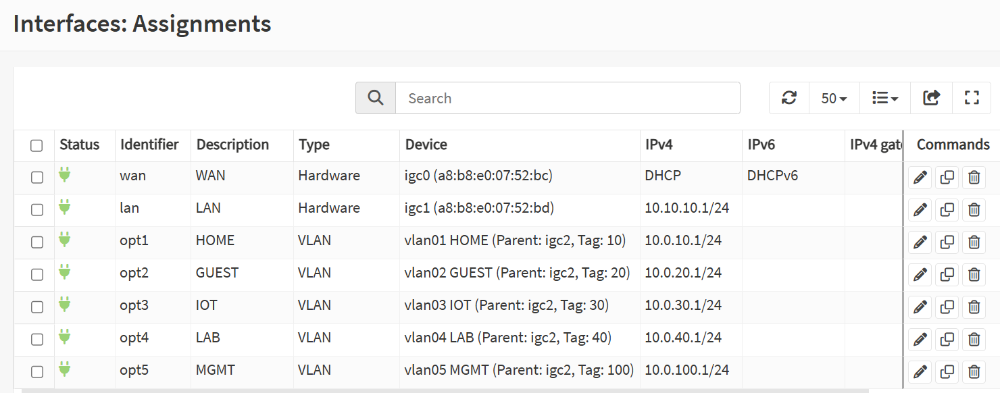

# 🧱 Phase 4 — VLAN Segmentation + 802.1Q Trunk


[← Back to main page](../README.md)

## Lab Summary
Building network segmentation with five VLANs routed by OPNsense over a single 802.1Q trunk to the Cisco Catalyst switch. Each VLAN gets its own subnet, gateway, and DHCP scope, so every packet crossing a VLAN boundary passes through the stateful firewall.

> **Progress:** Section A (OPNsense configuration) ✅ complete · Section B (switch trunk + management move) ⏳ next · Section C (per-VLAN testing) ⏳ planned

## What I Built & Configured
- 🧭 Mapped the existing ISP equipment and designed the cutover path
- 📐 Designed an IP plan where the VLAN ID matches the third octet
- 🏷️ Created five 802.1Q VLAN interfaces on a dedicated trunk port (`igc2`)
- 📡 Extended DHCP to every VLAN with reserved space for static devices
- 🔥 Added temporary, clearly labeled test rules scoped to each VLAN's own subnet
- 🛟 Kept a separate admin port (`igc1`) as a lockout-proof path to the GUI

## 🗺️ Network Design

### Existing ISP Equipment
```
Coax → Spectrum E31U2V1 (cable modem only) → Spectrum Wi-Fi router (192.168.1.1) → LAB-SW1
```
The modem has no routing or Wi-Fi, so **bridge mode isn't needed**. At final cutover, OPNsense's WAN replaces the Spectrum router on the modem, and the Spectrum router is reused as a temporary single-network access point on the HOME VLAN until a VLAN-aware AP is installed.

### IP Plan

| VLAN | Name | Subnet | Gateway | DHCP Range |
|---|---|---|---|---|
| 10 | HOME | 10.0.10.0/24 | 10.0.10.1 | .100 – .200 |
| 20 | GUEST | 10.0.20.0/24 | 10.0.20.1 | .100 – .200 |
| 30 | IOT | 10.0.30.0/24 | 10.0.30.1 | .100 – .200 |
| 40 | LAB | 10.0.40.0/24 | 10.0.40.1 | .100 – .200 |
| 100 | MGMT | 10.0.100.0/24 | 10.0.100.1 | .100 – .200 |
| 999 | WAN-TRANSIT | ISP side | not routed internally | — |
| — | LAN (admin port, igc1) | 10.10.10.0/24 | 10.10.10.1 | .100 – .200 |

Addresses `.2`–`.99` in each VLAN are reserved for static devices (e.g., the switch at 10.0.100.2).

### Firewall Port Roles

| Port | Role |
|---|---|
| igc0 | WAN |
| igc1 | Dedicated admin port (safe path to the GUI during changes) |
| igc2 | 802.1Q trunk carrying VLANs 10, 20, 30, 40, 100 |

## 🔧 Step-by-Step Walkthrough

### Section A — OPNsense Configuration ✅

#### Step 1 — Create VLAN Devices
**Interfaces → Devices → VLAN.** Five VLANs, all with parent `igc2`: 10 HOME, 20 GUEST, 30 IOT, 40 LAB, 100 MGMT. Each VLAN becomes a virtual interface on one physical port; the 802.1Q tag on each frame tells the firewall which network it belongs to.

#### Step 2 — Assign and Address the Interfaces
Each VLAN was assigned as an interface, enabled, and given a static gateway address from the IP plan.



#### Step 3 — DHCP per VLAN

| Decision | Reason |
|---|---|
| Used **Dnsmasq** | Already serving LAN; also registers DHCP hostnames in DNS |
| Left **Kea** disabled | Two DHCP servers on one segment would hand out conflicting leases |
| Dnsmasq **Tag** field blank | It labels DHCP options, not 802.1Q VLANs |

#### Step 4 — Temporary Test Rules
New interfaces block all traffic by default. One temporary pass rule per VLAN was added to prove the plumbing works before real policy is written in Phase 5.

| Field | Value | Why |
|---|---|---|
| Interface (rule) | The VLAN | Applies to traffic entering that VLAN |
| Interface (origin) | Empty | "Received on" is only valid for outbound rules |
| Source | `<VLAN> network` | Only matches the VLAN's own subnet (anti-spoofing) |
| Destination | any | Temporary, for connectivity testing |
| State | keep state | Stateful: replies allowed automatically |
| Description | `TEMP allow all - <VLAN> - Phase 4 testing` | Easy to find and delete in Phase 5 |


### Section B — Switch Trunk + Management Move ⏳ Next
- Create VLANs 10, 20, 30, 40, 999 on LAB-SW1
- Move the ISP-side ports (Spectrum router uplink, OPNsense WAN) into **VLAN 999 WAN-TRANSIT**, so VLAN 100 becomes true management behind the firewall
- Configure Gi1/0/11 as an 802.1Q trunk to `igc2` (allowed VLANs pruned, DTP disabled)
- Move switch management to 10.0.100.2 with gateway 10.0.100.1

### Section C — Per-VLAN Testing ⏳ Planned
Verify each VLAN receives the correct DHCP lease, reaches its gateway, and reaches the internet.

## 🛠️ Troubleshooting & Challenges

### Subnet Overlap Between HOME and the Admin Port
❌ **Problem:** HOME (VLAN 10) was first addressed as 10.10.10.1/24, the same subnet as the LAN admin port on `igc1`.

🔍 **Root Cause:** Two interfaces in the same subnet make routing ambiguous; the firewall can't tell which interface 10.10.10.x devices live on.

✅ **Fix:** Re-addressed all VLANs to 10.0.X.0/24 (VLAN ID = third octet), keeping the admin port at 10.10.10.1. Done from the GUI on the VLAN interfaces, never the interface I was connected through, so there was no lockout risk.

### Rule Sources Saved as "any"
❌ **Problem:** The first temporary rules showed `*` as the source instead of the VLAN's network.

🔍 **Root Cause:** The source selection didn't persist when the rules were created.

✅ **Fix:** Edited each rule to use `<VLAN> network` and verified the rules list showed the correct source.

### Finding: Default Admin Credentials on the ISP Router
🔍 The Spectrum router's label lists a default admin login. Flagged to verify it has been changed and to disable WPS before the router is repurposed as an access point.

## ✅ Phase Progress

| Task | Status |
|---|---|
| ISP equipment mapped, cutover path designed | ✅ |
| IP plan (VLAN ID = third octet) | ✅ |
| Five VLAN interfaces on `igc2` | ✅ |
| DHCP scope per VLAN | ✅ |
| Temporary per-VLAN test rules | ✅ |
| Switch VLANs + WAN-TRANSIT | ⏳ |
| 802.1Q trunk to OPNsense | ⏳ |
| Switch management moved to VLAN 100 | ⏳ |
| Per-VLAN connectivity tests | ⏳ |

## 📚 What I'm Learning
Designing the IP plan first, and checking it against what already exists, prevents problems that are hard to diagnose later. The HOME/admin-port overlap was caught before any traffic was affected. Keeping a separate admin port during changes is a simple way to make risky network work safe.
